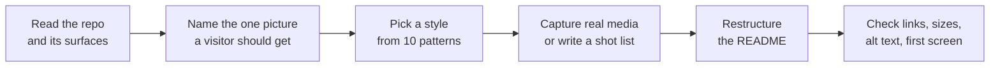

<div align="center">

# readme-showcase

**Turn a repo's README into a product page that gets across in seconds.**

An agent skill for Claude Code, Codex and other `SKILL.md` agents.

[Install](#install) · [Use](#use) · [What's inside](#whats-inside) · [Limits](#limits) · [繁體中文](README.zh-TW.md)

</div>

Most visitors decide on the first screen whether to keep reading. This skill makes your agent work out what a visitor should understand in five seconds, pick a README style that fits the project, capture real demos and screenshots, restructure the README, and check the result.

It starts from what your project can honestly show, not from a template. A CLI, a browser extension, a desktop app and a library each get a different kind of picture. When a capture needs a human, such as a permission prompt or a recording with sound, it hands you a shot list instead of faking it.



## Install

The skill is the `readme-showcase/` folder in this repo. Clone the repo, then copy that folder to where your agent looks for skills.

```bash
git clone https://github.com/xu-0306/readme-showcase.git
cd readme-showcase
```

**Claude Code**

```bash
cp -r readme-showcase ~/.claude/skills/
```

**Codex** (CLI, IDE extension, app)

```bash
cp -r readme-showcase ~/.agents/skills/
```

On Windows PowerShell, use `Copy-Item -Recurse readme-showcase $HOME\.claude\skills\` or `$HOME\.agents\skills\`.

To share it with a team, put the folder in a repo's `.claude/skills/` (Claude Code) or `.agents/skills/` (Codex) instead.

## Use

It triggers on its own when you ask to present, showcase or improve a repo, or ask for a demo GIF, hero image, screenshots or an architecture diagram for a README. To call it by name:

| Agent | Command |
|---|---|
| Claude Code | `/readme-showcase` |
| Codex | `$readme-showcase`, or pick it from `/skills` |

Example requests:

- "My README is plain text. Make it look like the popular repos."
- "Make a demo GIF for this CLI and put it at the top of the README."
- "Add an architecture diagram and a short quick start."

The skill tells you the plan before it produces anything expensive: the style, the hero, which media it can capture itself, and which need you.

## What's inside

```text
readme-showcase/
├── SKILL.md                       six-step workflow and boundaries
├── references/
│   ├── readme-patterns.md         10 README styles, how to choose, GitHub-safe HTML
│   └── media-recipes.md           capture recipes per surface, shot-list template
└── scripts/
    └── check_readme_assets.py     checks images, links, sizes and the first screen
```

**The 10 styles** come from reading 24 popular repositories' READMEs:

| Style | What leads |
|---|---|
| Demo-first loop | A short silent recording of the product doing its main job |
| Video hero | An embedded clip, room for sound or a longer flow |
| Screenshot-led | One real screenshot, then bold-led features and a short install |
| Per-feature media | Each feature heading has its own captioned shot |
| Code as demo | A copy-paste command or a ten-line snippet |
| Matrix-led | Tables of features or downloads by platform |
| Evidence-led | A measured number, chart or paper |
| Showcase-led | Named things built with the project |
| Pointer | Logo, one line, link to the site |
| Reference manual | Table of contents and a section per option |

Styles combine, and most good READMEs are one hero style plus one body style. `readme-patterns.md` says how to choose from the project's characteristics, not its tech stack.

**The check script** is standard-library Python:

```bash
python readme-showcase/scripts/check_readme_assets.py README.md
```

It reports missing local files and broken relative links (errors), and images without alt text, oversized media, repo-relative video and a first screen with no image (warnings). `--self-test` runs its built-in test.

## Limits

- **Experimental.** I have not yet compared READMEs made with the skill against READMEs made without it.
- **Media tools are separate installs.** The recipes use [VHS](https://github.com/charmbracelet/vhs), [Playwright](https://playwright.dev), `ffmpeg` and Mermaid. The skill checks whether a tool exists and tells you the install command if it does not.
- **Some captures need you.** Browser tab capture, microphone access and anything behind a login cannot be scripted honestly. You get a shot list, then the agent trims, crops and compresses your recording.
- **It does not publish.** It edits the README and adds files locally. Committing, pushing, editing the repo's About text and publishing a release wait for your go-ahead.
- **Codex paths** follow [OpenAI's skills documentation](https://learn.chatgpt.com/docs/build-skills), which may change.

## License

[MIT](LICENSE)
