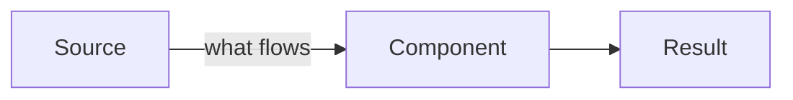

# Media recipes

Pick by **surface** - where the project is visible - not by language or framework. Check that a tool is installed before planning around it (`vhs --version`, `ffmpeg -version`, `npx playwright --version`); if it is missing, tell the user the install command instead of silently switching approach.

## Contents

- [Budgets and formats](#budgets-and-formats)
- [Terminal](#terminal)
- [Web page or browser extension](#web-page-or-browser-extension)
- [Desktop window](#desktop-window)
- [No visible surface](#no-visible-surface)
- [Architecture diagram](#architecture-diagram)
- [Hero banner or logo block](#hero-banner-or-logo-block)
- [Converting and shrinking](#converting-and-shrinking)
- [Shot list template](#shot-list-template)

## Budgets and formats

| Format | Use for | Notes |
|---|---|---|
| PNG | UI screenshots, diagrams | Sharp text. Capture at 2x and display at a fixed `width`. |
| GIF | Short loops, 3-12 s | Plays inline everywhere. Keep under about 8 MB; 10-15 fps and 800 px wide is usually enough. Cannot adapt to light/dark. |
| MP4 / WebM | Longer demos with detail | Plays inline on GitHub only when uploaded through the GitHub web editor (it becomes a `user-attachments` URL). A repo-relative `.mp4` renders as a plain link. Keep a GIF or poster image as fallback. |
| SVG | Logos, banners, simple diagrams | Scales cleanly. GitHub sanitizes SVG and README HTML (no `<script>`, no `<style>` in the README itself); if the SVG is animated, confirm on the rendered page that it still moves. |
| Mermaid fence | Architecture and flow | Rendered natively by GitHub and follows the viewer's theme. Not rendered on every mirror or package registry. |

Light and dark: static images can switch with `<picture>` and `prefers-color-scheme` (see `readme-patterns.md`). Anything that cannot switch should be legible on both: give screenshots their own background or a thin border, avoid transparent PNGs with dark text.

Motion: when a hero is animated, offer a still for people who turned animations off:

```html
<picture>
  <source media="(prefers-reduced-motion: reduce)" srcset="docs/media/hero.png">
  
</picture>
```

## Terminal

Use [VHS](https://github.com/charmbracelet/vhs): a `.tape` script renders a reproducible GIF, MP4 or WebM. It needs `ttyd` and `ffmpeg` on PATH. Windows: `winget install charmbracelet.vhs`.

```
Output docs/media/demo.gif
Set FontSize 18
Set Width 1000
Set Height 560
Set TypingSpeed 60ms
Type "mytool scan ./project"
Enter
Sleep 3s
```

- Show one task from start to result. Cut waiting with `Hide`/`Show` or a faster sample input rather than long sleeps.
- Use a throwaway directory and fake but realistic data. The prompt, hostname and paths are in the shot.
- Commit the `.tape` file beside the GIF.

For a session that cannot be scripted, record with the OS screen recorder and convert (below).

## Web page or browser extension

Use Playwright: a script drives the real page and records it.

```js
const context = await browser.newContext({
  viewport: { width: 1280, height: 720 },
  deviceScaleFactor: 2,
  recordVideo: { dir: 'tmp/video', size: { width: 1280, height: 720 } },
});
const page = await context.newPage();
// ... real interactions ...
await page.screenshot({ path: 'docs/media/feature.png' });
await context.close(); // the video file is only written on close
```

- Screenshots: set the viewport, wait for the state you want, hide scrollbars and caret, crop to the part that matters (`locator.screenshot`).
- Extensions need a persistent context with `--load-extension=<dir>` and `--disable-extensions-except=<dir>`, in a headed or new-headless Chromium.
- Some browser features only start on a real user gesture or permission prompt (tab or screen capture, microphone, some extension actions). A script cannot honestly produce those. Capture the surrounding UI by script and write a shot list for the gated part.
- Use content you may publish. For a tool that works on top of other sites or media, use your own page, a public-domain or permissively licensed clip, or a test page from the repo.

## Desktop window

In order of preference:

1. **The toolkit's own render**, if the app can draw a window to an image from a script (Qt `QWidget.grab()`, Electron `capturePage`, a test harness screenshot). Reproducible, no desktop clutter. Offscreen renders can miss OS effects such as translucency, so compare one against the real window.
2. **Record the real window** with ffmpeg:
   - Windows: `ffmpeg -f gdigrab -framerate 15 -i title="Exact Window Title" -t 10 tmp/app.mp4`
   - macOS: `ffmpeg -f avfoundation -framerate 15 -i "1:none" -t 10 tmp/app.mp4` (then crop)
   - Linux/X11: `ffmpeg -f x11grab -framerate 15 -video_size 1280x720 -i :0.0+100,100 -t 10 tmp/app.mp4`
3. **The OS recorder** driven by the user, with a shot list.

Use a clean profile or temporary config so personal data, real file paths and account names are not in the shot. Set a fixed window size so screenshots line up.

## No visible surface

Libraries, protocols, services and optimizers still have something to show:

- **Input and output side by side**: the call and what comes back, as a code block pair or a two-column table.
- **Before and after**: the same task with and without the project.
- **A number with its source**: a small table or chart from a measurement the repo can reproduce. Link the script or the raw data. No measurement, no number.
- **A diagram** of where the project sits between the things the reader already knows.

A terminal recording of the test suite or a REPL session is a fair hero for a library when it shows a real result.

## Architecture diagram

Start with a Mermaid fence: it is text, it diffs, and GitHub renders it in the viewer's theme.

````markdown

````

- Name boxes by what they do for the user, with the technology in smaller type if at all.
- Five to nine boxes. A diagram that needs more is two diagrams, or belongs in `docs/`.
- Label the arrows with what travels along them.
- Need a static asset (for a package registry or social card)? Render with `npx -p @mermaid-js/mermaid-cli mmdc -i diagram.mmd -o docs/media/architecture.svg`.

A hand-drawn or designed diagram (Excalidraw, D2, draw.io) is worth it only when layout carries meaning Mermaid cannot express. Keep the source file in the repo.

## Hero banner or logo block

Only when the project has, or the user wants, a visual identity. A plain centered title with a real screenshot under it is a complete first screen.

- Build the banner as a small HTML page and screenshot it with Playwright at 2x, or write an SVG by hand. Keep the source.
- Make a light and a dark version when the logo has fixed colours, and switch with `<picture>`.
- No generated artwork that imitates another project's brand, and no stock imagery that says nothing about the product.

## Converting and shrinking

Video to GIF with a generated palette (one pass, good colour):

```bash
ffmpeg -i tmp/in.mp4 -vf "fps=12,scale=800:-1:flags=lanczos,split[a][b];[a]palettegen=max_colors=128[p];[b][p]paletteuse=dither=bayer" docs/media/out.gif
```

- Trim first: `-ss 2 -t 8` before `-i` for a fast cut.
- Too big? In order: shorten, lower fps (10), reduce width (720), reduce colours (64), crop to the active region (`crop=w:h:x:y`).
- Speed up dead time instead of showing it: `setpts=0.5*PTS`.
- `gifsicle -O3 --lossy=80 in.gif -o out.gif` shrinks further if installed.
- Check the result frame by frame once (`ffmpeg -i out.gif -vf "select=eq(n\,0)" -frames:v 1 tmp/first.png`): the first frame is what people see before it plays, and what a paused or reduced-motion viewer keeps.

PNG: capture at 2x, then set `width` in the `` tag. Compress with `oxipng` or `pngquant` if installed.

## Shot list template

Give this to the user when a capture needs them.

```markdown
## Shot: <name> -> docs/media/<file>

Purpose: <the one thing the viewer should understand>
Setup:   <app state, sample content to open, window size, theme, zoom>
Hide:    <bookmarks bar, notifications, personal tabs, real file paths>
Action:
  0-2 s  <still frame that already makes sense on its own>
  2-8 s  <the action, and the result appearing>
  8-10 s <hold on the result>
Record:  <tool and settings, e.g. Win+Alt+R, region or window, 30 fps>
Save as: tmp/<name>.mp4  (raw; I will trim, crop and convert)
```
